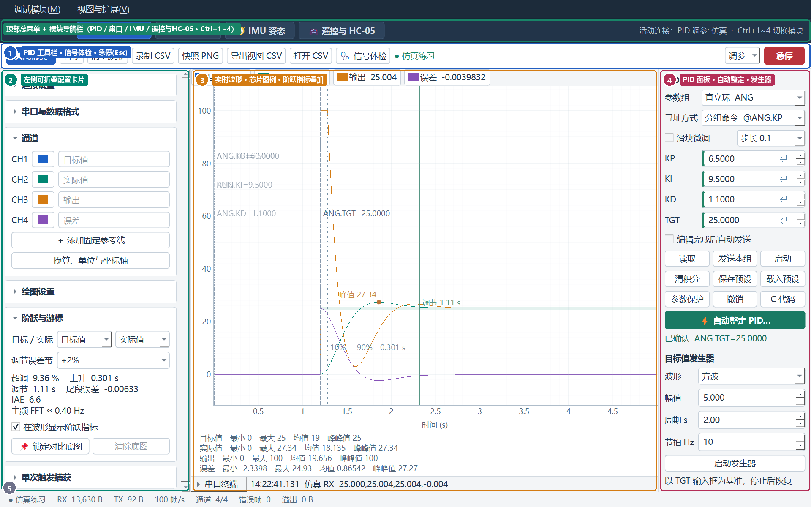
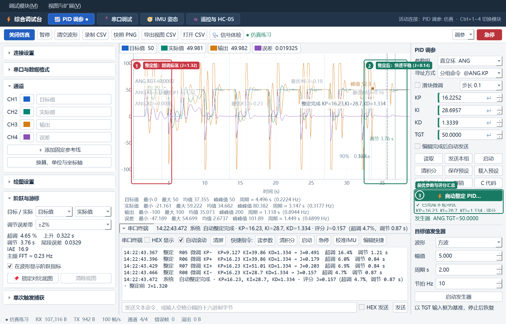
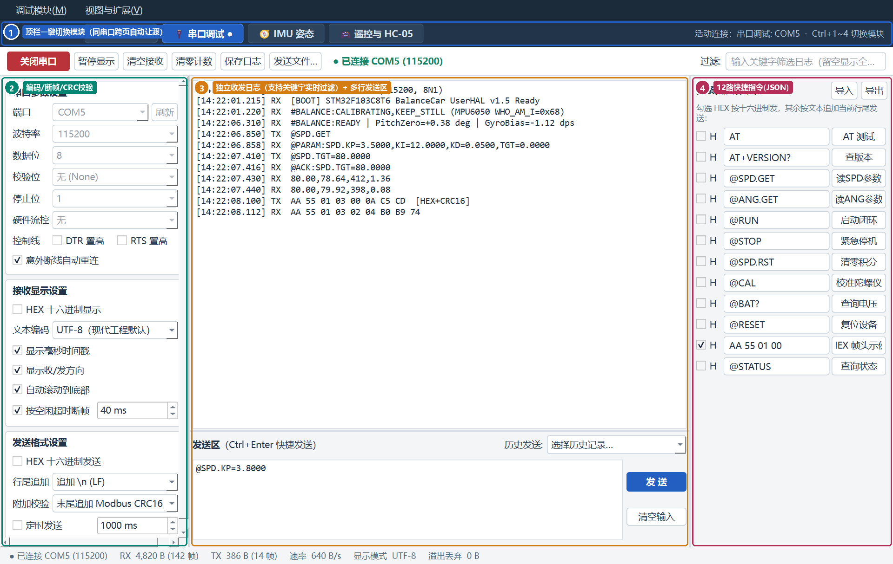
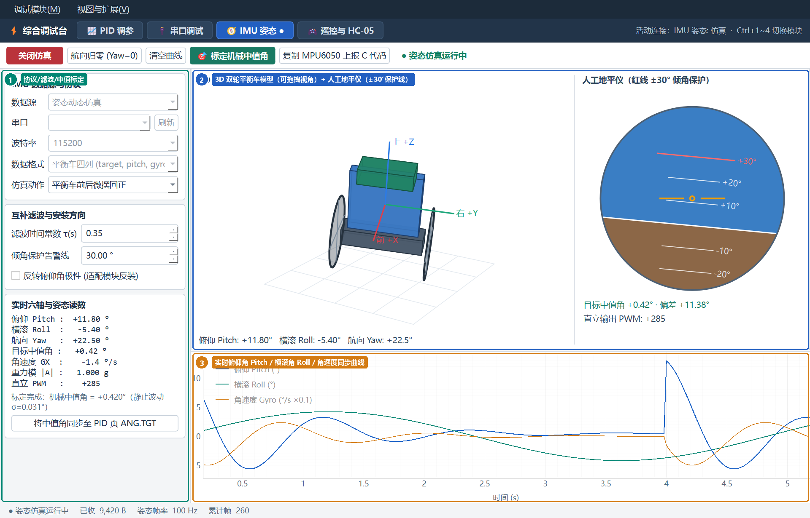
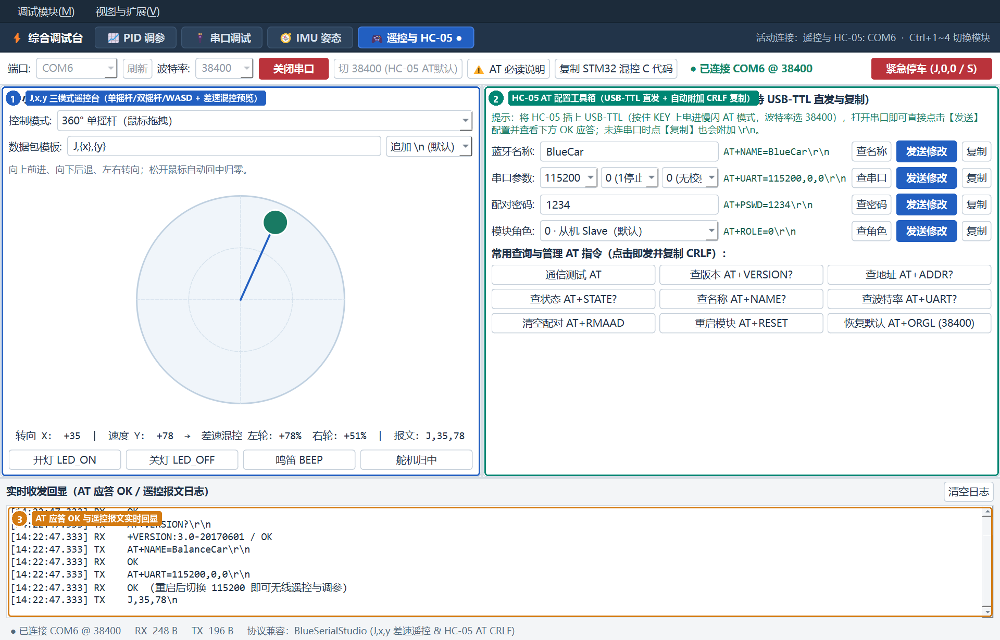

# EmbeddedDebugStudio | 嵌入式综合调试助手

[](https://github.com/xyu-06/EmbeddedDebugStudio/actions/workflows/build-windows.yml)

面向 **STM32 电机控速、双轮平衡车与多传感器嵌入式开发** 的可扩展 PC 端一体化调试工作台（Python 3.11 + PySide6 + PyQtGraph）。  
与 Android 端 **[BlueSerialStudio | 蓝牙串口实验室](https://github.com/xyu-06/BlueSerialStudio)** 协议生态完全互通。

---

## 下载免安装可执行程序与图文手册

👉 **[前往 GitHub Releases 下载最新 Windows 免安装版 EXE 与 PDF/Word 图文使用手册](https://github.com/xyu-06/EmbeddedDebugStudio/releases/latest)**

- **Windows 免安装单文件**：下载 `PIDTuner.exe`（或 `EmbeddedDebugStudio-v1.8-win64.exe`）双击即用，无需安装 Python 环境。
- **在线阅读完整图文操作手册**：[点击在线查看完整图文使用手册 (docs/MANUAL.md)](docs/MANUAL.md)（Releases 中亦提供打包好的 `.pdf` 与 `.docx` 离线文档）
- **历史版本归档**：`v1.1` → `v1.8` 各历史版本的安装包、源码快照与配套操作手册均完整归档于 [Releases 页面](https://github.com/xyu-06/EmbeddedDebugStudio/releases)。

---

## 五大内置调试工作台（顶栏菜单 / `Ctrl+1~5` 一键切换）

支持**跨模块同串口冲突智能让渡**（切换模块打开同一 `COM` 口时自动安全释放原页面连接并无缝接管）与**跨页面全局 `Esc` 最高优先级急停**（含断开连接前硬件缓冲冲洗发停机指令）。

### 1. 📈 PID 闭环调参与智能自动整定（`Ctrl+1`）
- **高刷多通道示波器**：支持 **1～8 通道实时曲线** + 4 条固定/跟随参考线、通道缩放系数与工程单位换算、独立双 Y 轴分流（如左轴转速 `RPM`、右轴 `PWM`）、单次边沿触发抓拍、A/B 双游标测量与历史 CSV 离线导入回放。
- **三色状态安全调参与原子组写入**：支持 `ANG / SPD / YAW / AUX` 四环独立参数、原子下发 `@<GRP>.SET=kp,ki,kd,tgt`（`#CAP:SET` 探测，防新旧参数短暂混用）、连续滑块微调 + 5 档步长、上下限保护、大幅跳变二次确认与一键撤销。
- **⚡ 智能 PID 自动整定（Auto-Tune）**：无需修改单片机固件，自动辨识 + Hooke–Jeeves 多轮寻优；支持 **直立环 `ANG` 强制局部微调（单轮 `≤±35%`）、车轮架空安全勾选确认、失败/超时/断线自动写回原参数**，并内置带 `25 ms` 滞后、传感器噪声及 `👋 推一下` 扰动按钮的倒立摆仿真。
- **📌 Ghost 同起点残影对比 + 🩺 FFT 信号体检 + 📋 C 代码导出**：锁定旧参数阶跃底图同起点叠加对比；一键分析零偏、底噪 `σ` 与 FFT 主振荡频率；一键生成 STM32 `#define` 参数宏代码。





### 2. 🔌 独立增强版串口调试助手（`Ctrl+2`）
- 支持 `4800 ~ 2000000` 自定义波特率、`DTR / RTS` 硬件流控电平控制与断线自动重连；
- 支持 **`UTF-8 / GBK / Latin-1` 多编码切换**、`ASCII / HEX` 收发、**按空闲超时自动断帧（ms 可调）**、**关键字实时过滤日志**；
- 支持自动追加 **`Sum8 / XOR8 / Modbus CRC16` 校验码**、周期定时发送、文件分块发送，以及右侧 **12 路支持 JSON 导入/导出的多条快捷指令集**。



### 3. 🧭 3D IMU 姿态与六轴标定工作台（`Ctrl+3`）
- 零 OpenGL 依赖渲染可拖拽视角的 **3D 双轮平衡车实时模型** + **航空人工地平仪（带 `±30°` 红色倾角保护线）** + 实时姿态曲线，内置无硬件动态姿态仿真；
- 原生支持平衡车四列（`target,pitch,gyro,pwm` 及 `#BALANCE:` 状态告警）、欧拉角三列、六轴物理量与 `MPU6050` 原始寄存器计数（内置实时可调 `τ` 一阶互补滤波器）；
- 支持 **50 帧静止采样一键标定机械中值角**，并一键同步写入 PID 页 `ANG.TGT` 及复制 `MPU6050` 串口上报 C 代码片段。



### 4. 🎮 小车差速遥控与 HC-05 AT 配置工具箱（`Ctrl+4`）
- **兼容 `BlueSerialStudio` `J,{x},{y}` 差速遥控协议**：支持 **360° 单摇杆**、**左右双摇杆**、**四按键 / 键盘 `WASD` 长按渐进加速（18%→100%）** 三种控制模式，实时预览 `BlueSerial_MixWheels` 左右轮混控输出；内置窗口失焦/隐藏自动清零 `J,0,0` 防卡键保护与非零摇杆 `100 ms` 心跳重发保活，切页或按 `Esc` 立即急停。
- **HC-05 USB-TTL 串口直连 AT 配置箱**：自动附加标准 `CRLF (\r\n)`，支持完整波特率表（含 `57600` 及对 `5760` 疑误项的二次安全确认）并在写入 `AT+UART=` 前自动发送 `AT+UART?` 读出对比，避免误写导致模块失联。



### 5. 🧩 统一单片机串口接口构建与说明中心（`Ctrl+5`）
- **统一收拢全软件三大串口接口**：集中生成 **📈 PID 闭环调参**（支持 1～8 通道任意调序与 `#ROLES:` 绑定）、**🧭 IMU / MPU6050 姿态**（4 种数据格式 + `#BALANCE:` 状态横幅）、**🎮 小车差速遥控 `J,x,y`**（对齐 `BlueSerial_MixWheels` 混控与失联自动停车保护）；各调试页顶栏均提供 **🧩 接口与说明** 一键直达按钮。
- **覆盖 STM32 HAL / 标准库 SPL / ESP32·Arduino**：原生支持 **STM32 HAL 库（CubeMX · 零 `printf_float`）**、**STM32 标准外设库 SPL（`stm32f10x.h` · `USARTx` 中断）** 与 **ESP32 / Arduino（`.ino`）** 三大目标工程；支持一键复制、导出全部源码文件至目录，并提供随所选接口与平台动态切换的 **📖 协议与使用配置说明**。

---

## 插件化模块扩展架构（`WorkbenchModule`）

后续接入 **📷 摄像头图传（OV7670 / OpenMV）**、CAN 总线分析仪等新工具时，只需新建一个 `QWidget` 子类实现标准 `WorkbenchModule` 接口并在 `main.py` 注册一行：

```python
self.register_module("📷 摄像头调试", CameraDebugPage(self))
```

即可自动获得顶栏模块页签、菜单栏快捷键、暗色主题同步、配置持久化与跨模块串口冲突自动让渡。可在软件菜单 **【视图与扩展(V) → 模块扩展接口说明…】** 查看完整模板代码。

---

## 目录结构

| 路径 | 说明 |
| :--- | :--- |
| `main.py` / `layout_ui.py` / `workbench.py` | 多模块综合工作台宿主、PID 主界面布局、主题与全局快捷键 |
| `serial_studio.py` | 独立全功能串口调试助手模块（UTF-8/GBK、CRC16、12 路快捷指令） |
| `imu_studio.py` | 3D 平衡车姿态、人工地平仪、六轴互补滤波与中值角标定模块 |
| `remote_studio.py` | `J,x,y` 小车差速遥控台与 HC-05 USB-TTL AT 配置工具箱模块 |
| `firmware_studio.py` | 统一串口接口构建与说明中心（PID/IMU/遥控 × HAL/SPL/ESP32·Arduino）与内置动态协议说明书 |
| `autotune.py` / `autotune_ui.py` | 闭环阶跃辨识（SIMC / 极点配置）+ Hooke–Jeeves 自动整定引擎 |
| `diagnostics.py` / `scope.py` / `engine.py` | FFT 信号体检、C 代码导出、高刷示波器（含 Ghost 底图）、协议解析与仿真器 |
| `firmware_example/` | STM32 C99 零 `printf_float` 依赖协议栈 `pid_link.c/.h`、HAL 队列与平衡车三环串级模板 |
| `tests/` & `test_tuner.py` | STM32 C99 协议/平衡车闭环测试与 36 项 Python 自动化回归测试 |
| `.github/workflows/build-windows.yml` | GitHub Actions 自动运行 C + Python 全套测试并构建单文件 `PIDTuner.exe` |

---

## 本地开发、测试与打包

环境要求：Windows 10/11 x64，Python 3.11。

```powershell
# 1. 安装依赖
pip install -r requirements.txt

# 2. 运行源码
python main.py

# 3. 运行回归测试与自检
python -m unittest -v test_tuner.py
python main.py --self-test

# 4. 打包单文件 release/PIDTuner.exe
./build.ps1
```

> **安全提示**：首次连接真实电机驱动器或平衡车前，请务必先**将车轮架空离开地面**，验证键盘 `Esc` 急停（`@STOP` / `J,0,0`）与拔线 `0.5 s` 心跳超时自动停机保护正常后再落地调试。
