# 嵌入式综合调试助手 v1.9 · 图文使用手册（PID / 串口 / IMU / 蓝牙遥控 / 接口构建）

面向 **STM32 电机控速、双轮平衡车与多传感器系统** 的可扩展一体化上位机指南：集 **【📈 PID 调参】**、**【🔌 串口调试】**、**【🧭 IMU 姿态】**、**【🎮 遥控与 HC-05】**、**【🧩 接口构建】** 五大工作台于一体，并与 Android 端 [BlueSerialStudio](https://github.com/xyu-06/BlueSerialStudio) 协议完全互通。

> [!TIP]
> **v1.9 实车调试可信度与闭环效率亮点速览**
> - **🧭 统一通道语义、MCU 时间戳与静止判稳**：PID 页、`balance_example.c`、【接口构建】与【IMU 姿态】共用规范 5 列（`pitch_target,pitch,gyro_pitch,pwm,wheel_speed`）与工程单位；未上报项明确提示 `未上报`；IMU 支持 `seq,mcu_ms` 时间戳或固定采样周期对抗蓝牙合包失真，并拒收晃动中的 50 帧中值标定。
> - **📉 负载扰动对比与长录制分段回放**：单次触发捕获新增 `负载扰动对比`（一键给出最大掉速、卸载冲高、恢复时间、PWM 饱和时长与同触发点 Ghost 对比 + A/B 游标复算）；导入超 `20,000` 行 CSV 时支持自由挑选 `[t_start, t_end]` 回放时段。
> - **🧩 统一接口构建与说明中心（`Ctrl+5`）与 `#ROLES:` 协议**：各工作台顶栏提供 **🧩 接口与说明** 快捷直达按钮，将 **PID 调参 / IMU MPU6050 姿态 / 差速遥控 `J,x,y`** 三大接口统一收拢管理；支持 **STM32 HAL 库**、**STM32 标准外设库 SPL (`stm32f10x.h`，含真实 `GPIO_Init`)** 与 **ESP32 / Arduino（含严格浮点校验）** 一键生成导出。
> - **🔵 全模块蓝牙 SPP 直连与冲突让渡**：PID 调参、串口调试、3D IMU、蓝牙遥控四大工作台均可直接扫描配对并无线直连经典蓝牙 SPP（`RFCOMM`），跨页切接同一设备前自动冲刷停机指令并移交连接。
> - **⚡ 平衡车速度外环 `SPD` 自动整定与验收写回护栏**：`SPD` 自动整定精准绑定 `wheel_speed (RPM)` 实测转速；针对平衡车默认启用 `0 → 目标 → 0` 起步+刹停联合评分、探针/候选统一限幅、起步进入目标 `±5 RPM`、最大倾角 `≤ 12°` 与持续饱和硬门槛，全部不合格时严禁写回；优胜参数须经候选与原参数复测验证收益显著才写回，若原参数复测失效则自动补测或标注对照不足暂缓写回，并覆盖 `SETTLE_BASE / OBSERVE / OBSERVE_BRAKE` 三阶段约 1 s 断流急停保护。
> - **⚡ 顶栏总菜单 + 五大模块一键切换（`Ctrl+1 ~ 5`）**：支持跨页面同串口冲突让渡（释放串口或断开连接前先冲洗写入急停报文）与全局 `Esc` 急停，预留 `WorkbenchModule` 插件扩展接口。
> - **📈 8 通道实时示波 + 原子 `@SET` + 自动整定安全保护（`Ctrl+1`）**：全面扩展至 **1～8 通道实时曲线**；支持 `@<GRP>.SET=kp,ki,kd,tgt` 原子写入与旧固件自动兼容；直立环 `ANG` 自动整定强制局部微调（单轮 `≤±35%`）、启动前必须勾选车轮架空确认、中途失败/超时/断线自动写回整定前原参数；倒立摆仿真新增 `25 ms` 执行器滞后、传感器噪声与 `👋 推一下` 扰动按钮。
> - **🎮 小车差速遥控 + HC-05 AT 配置工具箱（`Ctrl+4`）**：兼容 `J,{x},{y}` 三模式遥控（新增失焦/隐藏自动归零防卡键与非零摇杆 `100 ms` 心跳重发保活）；HC-05 工具箱补全 **`57600`** 标准波特率，将 **`5760`** 标注为“说明书原文，疑似笔误”并弹出二次确认，写入 `AT+UART=` 前自动发送 `AT+UART?` 读出对比再确认。
> - **🔌 独立增强版串口调试助手（`Ctrl+2`）**：支持 `UTF-8 / GBK / Latin-1`、`ASCII / HEX`、`DTR / RTS`、空闲超时断帧、关键字实时过滤、`Modbus CRC16` 自动校验、定时发送与 12 路 JSON 快捷指令集。
> - **🧭 3D 平衡车姿态与六轴标定（`Ctrl+3`）**：3D 双轮平衡车模型 + 人工地平仪（`±30°` 红线）+ 六轴实时互补滤波 + 一键标定机械中值角同步至 PID 页 `ANG.TGT`。

---

## 1. 软件全景与多模块导航架构

直接双击运行 [PIDTuner.exe](https://github.com/xyu-06/EmbeddedDebugStudio/releases/latest) 即可启动，无需安装 Python。主窗口最上方提供 **【调试模块(M) / 视图与扩展(V)】** 总菜单与常驻模块导航栏，点击页签或按 `Ctrl+1 ~ 5` 即可秒切工作台；任意正在连接或仿真的模块页签会自动亮起 `●` 指示点：

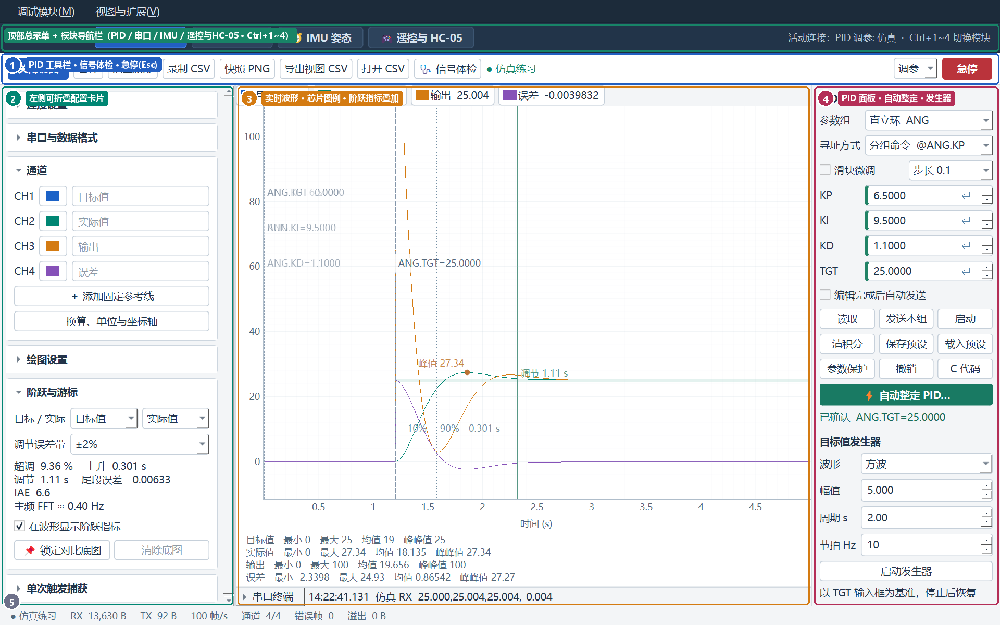

| 分区 | 名称 | 核心用途与高频操作 |
| :--- | :--- | :--- |
| **① 顶部栏** | 全局控制与急停 | 连接/断开、暂停（`Space`）、清空波形、录制 CSV、快照 PNG（`Ctrl+S`）、切换 **调参 / 分析 / 终端** 三种工作台布局、常驻红色 **急停（`Esc`）** |
| **② 左侧栏** | 可折叠设置卡片 | 串口/仿真数据源、`F5` 刷新端口、数据位/上报频率、通道命名与换算、绘图范围、阶跃误差带、单次边沿触发。连接成功后前两张卡片自动折叠让出视野 |
| **③ 中央区** | 高刷多通道示波器 | 最多 **8 通道**实时曲线 + 4 条参考线；上方彩色芯片显示实时读数并可单击显隐曲线；图内直接绘制 `±2% / ±5%` 误差带、峰值点、上升/调节时间及参数变更竖线 |
| **④ 右侧栏** | 常驻 PID 与激励面板 | 四环切换（`ANG / SPD / YAW / AUX`）、三色参数状态框、**⚡ 自动整定 PID**、**目标值发生器**、参数保护与一键撤销 |
| **⑤ 底部栏** | 串口终端与统计栏 | 默认折叠成单行最新报文，点击展开可收发原始命令或切换 `HEX` 视图；最底栏实时展示 `RX / TX` 字节数、帧率、错误帧与缓冲区溢出 |

### 30 秒免硬件体验流程
1. 打开程序后直接点击空白波形区中央的 **【试试仿真练习】**（或在左侧选择 `仿真练习 → 二阶振荡`，点顶部 **【打开仿真】** 再点右侧 **【启动】**）。
2. 在右侧 `TGT` 输入框输入 `25` 并按 `Enter` 回车：输入框左边框闪绿变为“已确认”，波形上同步落下 `ANG.TGT=25` 标记线并自动标出超调百分比、上升时间与调节时间。

---

## 2. 连接 STM32 串口、工程单位换算与独立双 Y 轴

以 `STM32F103C8T6` 搭配 USB-TTL（或蓝牙透传模块）为例：转换器 `RX` 接单片机 `TX`，`TX` 接单片机 `RX`，`GND` 共地。下位机只需按行输出逗号分隔数值（完全兼容 VOFA+ FireWater 格式），例如每 `10 ms` 发送一行 `15000,620\n`。

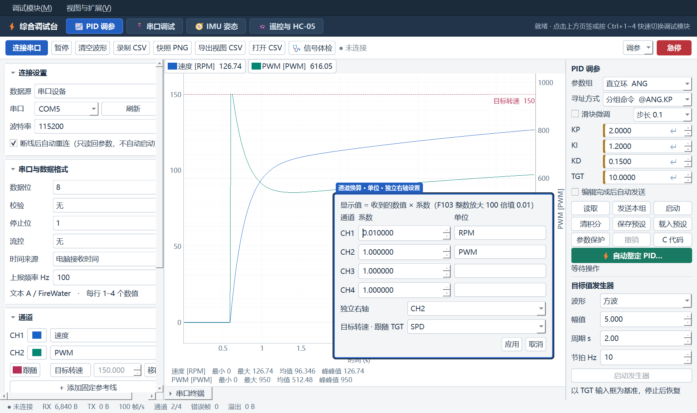

- **还原整数放大数据**：若 F103 将转速放大 100 倍按整数发送（如 `150.00 RPM` 发送 `15000`），点击左侧通道卡片的 **【换算、单位与坐标轴】**，将 `CH1` 系数设为 `0.01`、单位填 `RPM`，曲线与导出 CSV 即自动换算为真实物理转速。
- **速度与 PWM 分轴显示**：转速量级在 `0～200 RPM`，而电机 `PWM` 往往在 `0～7000`。在 **【独立右轴】** 中选择 `CH2`，即可让左轴看转速、右轴看 `PWM`，两条曲线共享时间轴且互不压扁。
- **参考线自动跟随目标值**：添加参考线时将 **【跟随已确认 TGT】** 绑定到 `SPD`，每次下发新目标转速并收到单片机确认后，图上的目标虚线会自动同步移动。

---

## 3. 在线调参、三色确认状态与防误操作保护

在右侧面板调节参数时，鼠标悬停在输入框上滚动 **滚轮** 为单倍步长微调，按住 **`Shift + 滚轮`** 为 10 倍步长快调；按回车单发当前项，或点击 **【发送本组】** 一次下发四项。

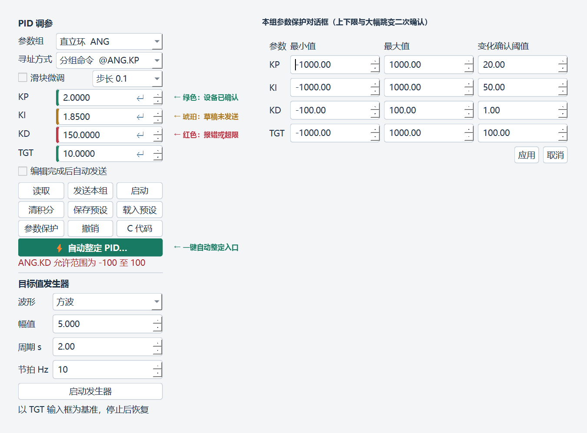

- **绿色左边框（已确认）**：单片机已返回匹配的 `@ACK` 或 `@PARAM`，屏幕上显示的数字就是芯片内正在运行的真实值。
- **琥珀色左边框（草稿）**：已在界面修改但尚未发送（或尚未收到确认）。
- **红色左边框（错误）**：超出允许上下限、设备返回 `@ERR` 或 `300 ms` 应答超时，输入框会轻微抖动提示并支持一键重试。
- **参数保护与一键撤销**：点击 **【参数保护】** 可设定每项参数的上下限与“大幅变化确认阈值”（防止多敲一个 `0` 导致飞车）；调坏参数时点击 **【撤销上次下发】** 即可回退上一组设备确认值。

---

## 4. 核心功能：智能 PID 自动整定（Auto-Tune）

只需给定目标值（例如“控速 `60`”或“目标角度 `25`”），软件即可根据返回的实时数值波形自动计算、下发验证并收敛到最佳 `KP / KI / KD` 组合，**全程走标准串口指令，无需改动下位机固件**。

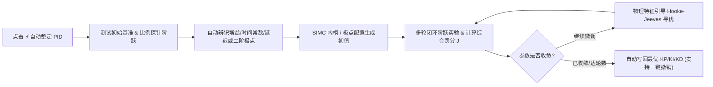

### 4.1 启动自动整定向导

连接串口或打开仿真后，选择要整定的环路（如 `速度环 SPD`），点击右侧绿色的 **【⚡ 自动整定 PID…】** 按钮打开配置窗口：

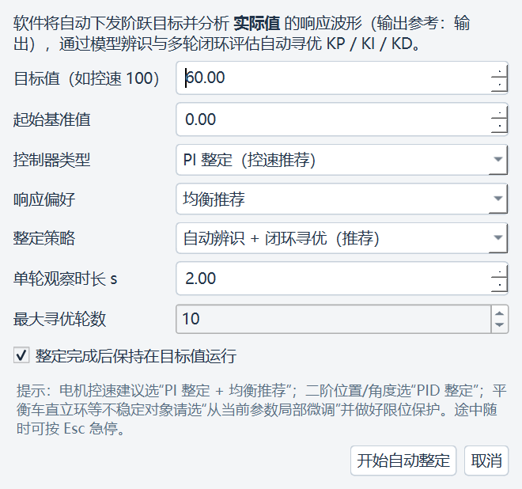

各选项填写建议如下：

| 配置项 | 电机控速推荐设置 | 位置 / 伺服云台推荐 | 平衡车直立环微调 |
| :--- | :--- | :--- | :--- |
| **目标值 / 起始基准** | `0` → 满占空比极限转速的 `40%~70%` | `0` → 常用行程中段位置 | `0°` → 小倾角（如 `3°~5°`） |
| **控制器类型** | `PI 整定（控速推荐）` | `PID 整定（位置/姿态）` | `PD 整定` 或 `PID 整定` |
| **响应偏好** | `均衡推荐` 或 `平稳无超调` | `平稳无超调` | `均衡推荐` |
| **整定策略** | `自动辨识 + 闭环寻优（推荐）` | `自动辨识 + 闭环寻优（推荐）` | **必选** `从当前参数局部微调` |
| **单轮观察时长** | 电机完整加速稳定时间的 `1.5~2` 倍（约 `1.5~3 s`） | 到位时间的 `1.5` 倍 | `1.5~2.0 s` |

> [!IMPORTANT]
> **为什么目标值不要设在电机 100% 极限满速？**
> 如果电机满占空比最高只能转到 `100 RPM`，目标也设 `100 RPM`，控制器输出会全程顶死在限幅上限，没有任何超调与动态加速余量。建议将整定目标设在 `50~70 RPM`，整定出的 `KP / KI / KD` 在全速段同样适用；若输出触顶饱和，软件也会在日志中主动提示。

### 4.2 观察自动寻优过程与前后对比

点击 **【开始自动整定】** 后，向导窗口关闭，软件自动循环执行 **“回基准稳态 → `@RST` 清零积分 → 阶跃至目标 → 采集曲线算分 $J$”**：

$$
J = w_1 \cdot \text{NIAE} + w_2 \cdot \text{NITAE} + w_3 \cdot E_{\text{tail}} + w_4 \cdot \max(0, \text{OS} - \text{OS}_0) + w_5 \cdot \text{Chatter}
$$

综合罚分 $J$ 同时衡量响应快慢（`NIAE`）、尾段收敛度（`NITAE` 与稳态误差 $E_{\text{tail}}$）、超调惩罚（`OS`）以及**控制输出高频抖动（`Chatter`，防止 `KD` 过大引起电机啸叫发热）**，$J$ 越低代表综合品质越优：

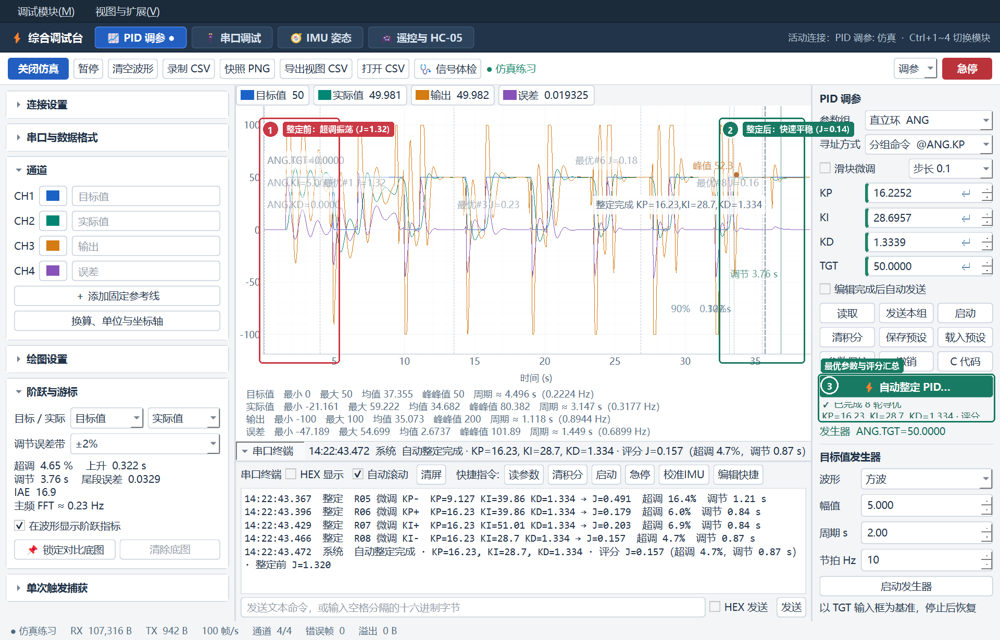

从上图可以看到：
1. **① 整定前（左段）**：初始参数 `KP=4, KI=5, KD=0` 产生大幅超调与持续振荡，罚分高达 `J = 1.324`；
2. **中间轮次**：软件经比例探针自动识别出欠阻尼二阶特性，计算出带微分阻尼的初值并在随后的轮次中微调，每次刷新纪录都会在波形上打下 `最优#k` 标记；
3. **②/③ 整定后（右段与右侧面板）**：第 8 轮收敛至 `KP=16.89, KI=30.4, KD=1.441`，罚分降至 `J = 0.138`，曲线干脆利落收敛到 `50`；如对结果不满意，随时点 **【撤销上次下发】** 即可一键恢复整定前的参数。

---

## 5. 目标值发生器与平衡车倒立摆仿真

- **周期性激励对比（图 6A）**：在右侧下方 **【目标值发生器】** 选择 `单次阶跃 / 方波 / 正弦 / 三角波`，设置幅值与周期后点 **【启动发生器】**。软件以启动时的 `TGT` 为中心自动按节拍发令，停止后自动恢复原 `TGT`。
- **倒立摆不稳定对象练习（图 6B）**：左侧仿真对象选择 **【倒立摆（平衡车直立）】**。该模型包含 `25 ms` 一阶执行器滞后与姿态测量噪声——无控制或 `KP` 过小时车身会加速倒下，倾角偏离超过 `45°` 时自动上报 `#STOP:fall` 清零输出并弹出红底保护横幅；工具栏提供 **【👋 推一下】** 按钮（`@NUDGE`）用于在线测试直立抗扰动恢复能力。
> [!NOTE]
> 仿真器与 STM32 固件共用同一套 `0.5 s` 看门狗规则：发送 `@RUN` 后若未持续收到 `@PING`，满 `0.5 s` 即自动停机（`#STOP:heartbeat`）。

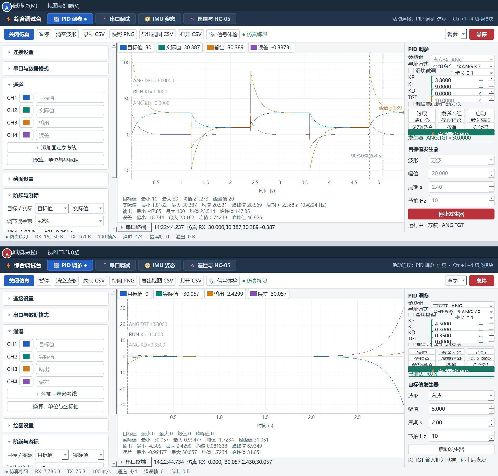

---

## 6. 单次边沿触发捕获、A/B 双游标与夜间模式

### 6.1 抓拍突加负载瞬态并测量恢复时间
在定速运行（如 `200 RPM`）时想测量外部阻力造成的跌落深度与恢复耗时：
1. 展开左侧 **【单次触发捕获】**，选择转速通道、电平 `192`、边沿选 `下降沿`，设置捕获时长与预触发比例（保留事件发生前的稳态波形），点击 **【单次触发】**。
2. 当转速跌破 `192` 并采满窗口后，画面自动暂停锁定；在曲线上依次单击两点放置 **游标 A、B**，下方读数条即直接给出 `Δt`（恢复时间）与 `ΔY`（幅值差）：

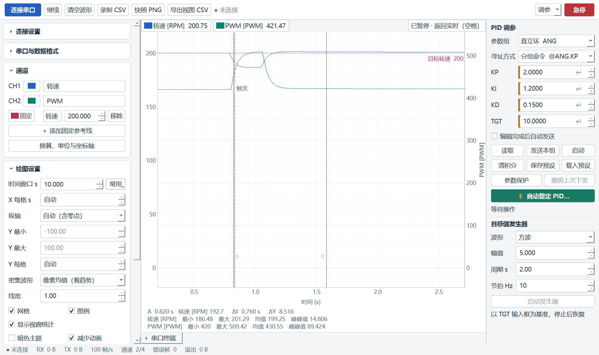

### 6.2 暗色护眼主题与串口终端调试
在左侧 **【绘图设置】** 勾选 **【暗色主题】** 可切换深色配色；点击波形下方 **【串口终端】**（或顶部布局选 `终端`）可查看带毫秒时间戳的收发明文、切换 `HEX 显示` 或手动发送 `@` 调试指令：

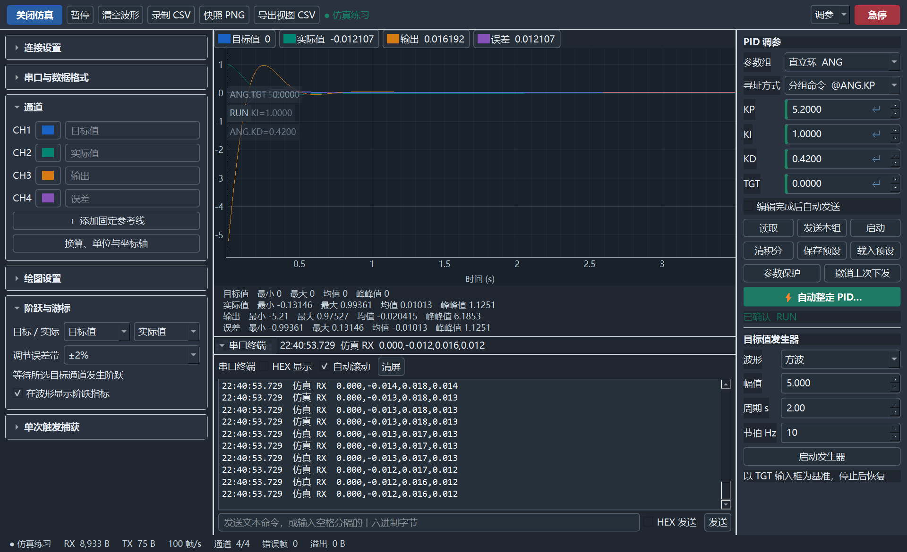

---

## 7. 进阶调试利器：同起点残影对比、滑块微调、信号体检与 C 代码生成

### 7.1 阶跃同起点残影对比（Ghost 底图）与连续滑块微调
调参对比时最怕“上一组波形已经滚走，靠记忆比快慢”：
1. 触发一次阶跃后，点击左侧 `阶跃与游标` 卡片里的 **【📌 锁定对比底图】**，当前响应会定格为**紫色虚线底图**；
2. 勾选右侧 **【滑块微调】**（支持切换 `0.001 ~ 10` 五档滚轮步长），拖动滑块调出一组新参数后再发阶跃，旧底图会**自动对齐到新阶跃的同一跳变起点重叠显示**，并在左栏同步列出新旧超调与调节时间对比：

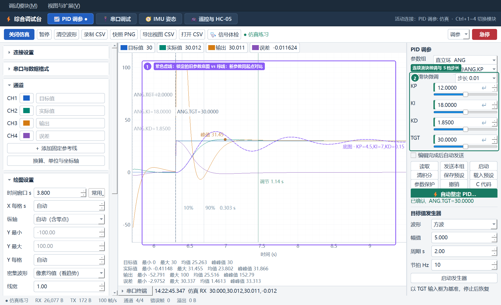

### 7.2 硬件与信号体检（零偏 / 底噪 / FFT 主频）与一键复制 C 代码
- **顶部【🩺 信号体检】（图 10A）**：一键统计可见区间各通道的**均值**（平衡车静止扶正时俯仰角均值即为机械中值角 `BALANCE_TARGET_PITCH_DEG`）、**标准差 `σ`**（传感器底噪）、**FFT 主振荡频率**（自动区分 `<4.5 Hz` 低频控制振荡与 `>18 Hz` 高频微分/量化噪声）以及 USB-TTL 攒批到达率，并可一键将实测帧率填入“固定上报周期”。
- **右侧【C 代码】（图 10B）**：调好参数后一键导出直接匹配你工程 `User/pid_debug.c`、`User/balance.c` 或四环结构体的 `#define` 宏定义代码到剪贴板，免去手抄出错。
- **顶部【打开 CSV】与终端【快捷指令】**：支持将任意历史录制的 CSV 重新导入软件离线缩放、放游标与做信号体检；展开串口终端后上方自带 5 个快捷指令按钮，左键即发、**右键点击任意按钮**即可自定义名称与命令。

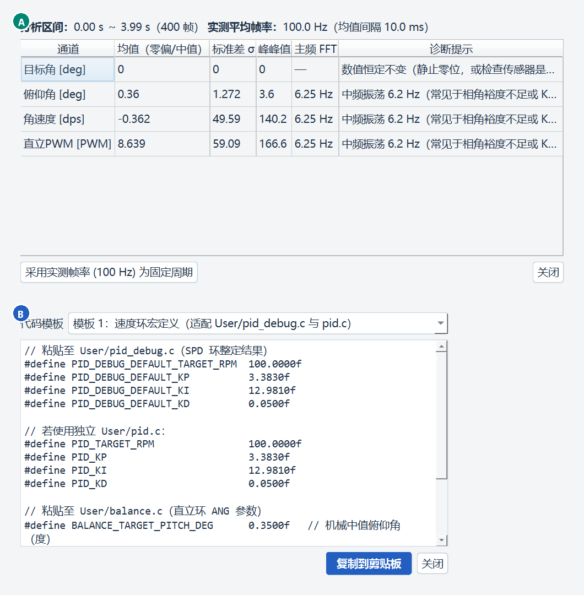

---

## 8. 独立全功能【🔌 串口调试】工作台（`Ctrl+2`）

除保留【PID 调参】页面底部折叠终端外，点击上方 **【🔌 串口调试】** 页签（或菜单 `调试模块 → 串口调试` / `Ctrl+2`）即可进入完全独立的专业级串口调试助手页面：

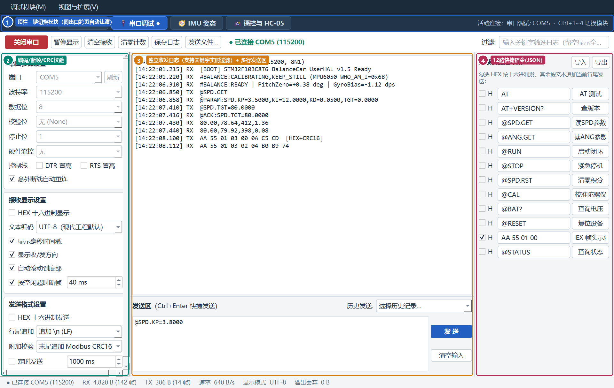

- **跨模块同串口智能让渡**：若 `COM5` 当前正连在【PID 调参】页，切到【串口调试】页直接点 **【打开串口】** 时，软件会自动弹窗询问并安全释放原页面的 `COM5` 连接后立即无缝接管，省去来回切换断开的繁琐。
- **中文编码与无换行断帧**：左侧支持切换 `UTF-8`、`GBK`（完美兼容 Keil 老工程中文 `printf` 不乱码）与 `Latin-1`，并支持按 **空闲超时（如 `40 ms`）自动断帧**，查看 Modbus 或自定义 HEX 数据包时每帧自动独立成行。
- **自动追加校验、定时发送与文件发送**：发送区支持 `Ctrl+Enter` 快捷发送、历史发送回溯、自动追加 `Sum8 累加和 / XOR 异或 / Modbus CRC16` 校验字节、周期定时发送以及最大 `256 KB` 文件分块下发。
- **关键字实时过滤 + 12 路快捷指令集**：右上角输入关键字（如 `#BALANCE` 或 `ERR`）即可实时筛选日志；右侧内置 **12 路独立快捷发送槽**（每路可单独勾选 `H` 按 HEX 发送，右键按钮可改名，并支持导出/导入 `.json` 指令集文件）。

---

## 9. 3D 可视化【🧭 IMU 姿态】与机械中值角标定（`Ctrl+3`）

点击顶栏 **【🧭 IMU 姿态】**（或按 `Ctrl+3`）进入专为 `MPU6050 / MPU6500` 与双轮平衡车定制的姿态解算与三维可视化页面（支持免硬件 **姿态动态仿真** 直接体验）：

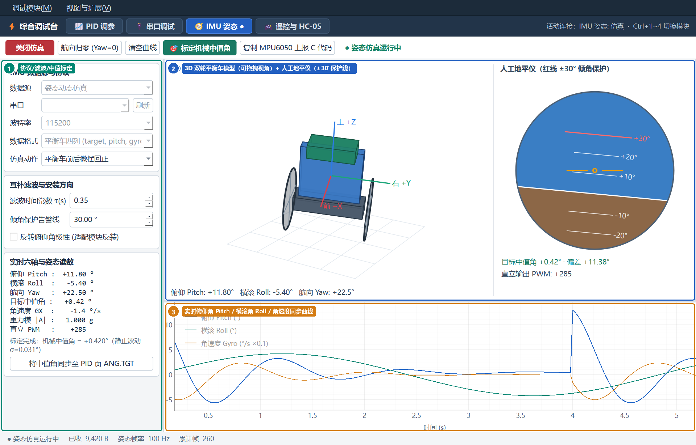

- **可交互 3D 平衡车 + 人工地平仪**：左半画布实时渲染双轮平衡车三维机体、随 `PWM` 旋转的车轮与机体 `+X/+Y/+Z` 坐标轴（左键拖拽旋转视角，双击复位，超出保护角车身自动变红告警）；右半画布为航空人工地平仪，醒目标出 **`±30°` 红色倾角保护线**。
- **原生兼容 4 种协议与在线互补滤波**：
  1. `平衡车四列 (target, pitch, gyro, pwm)`：直接对接你工程中的 `Doc/main_balance_test.c`，并原生识别 `#BALANCE:CALIBRATING`、`READY`、`TILT_STOP`、`INIT_ERROR=1..8` 弹出状态横幅；
  2. `欧拉角三列 (pitch, roll, yaw)`；
  3. `六轴物理量 (g, °/s)` 与 `MPU6050 原始计数 (16384 LSB/g, 131 LSB/°/s)`：上位机内置与 `User/balance.c` 同款的一阶互补滤波器（可在线调整时间常数 `τ`，默认 `0.35 s`）以及俯仰极性反转开关（适配模块反装）。
- **一键标定机械中值角并同步至 PID 页**：用手将小车扶正至自然重心平衡位置保持不动，点击顶部 **【🎯 标定机械中值角】** 自动采集 50 帧均值与底噪 `σ`，随后点 **【将中值角同步至 PID 页 ANG.TGT】** 即可一键写入直立环目标角并复制 `#define BALANCE_TARGET_PITCH_DEG` 宏定义！

> [!NOTE]
> **后续接入摄像头图传等新模块（插件化架构）**
> 点击顶部菜单 **【视图与扩展(V) → 模块扩展接口说明…】** 即可查看并复制标准 `WorkbenchModule` 模板代码。后续开发 **📷 摄像头调试（OV7670 / OpenMV 二值化与中线寻迹预览）** 或蓝牙遥控界面时，只需新建一个独立 `QWidget` 页面并在 [main.py](../main.py) 注册一行 `self.register_module(...)`，即可自动接入顶栏导航、快捷键、暗色主题与跨模块串口让渡体系。

---

## 10. 【🎮 遥控与 HC-05】工作台：蓝牙搜索配对、SPP 直连与 BlueSerialStudio 协议（`Ctrl+4`）

点击顶栏 **【🎮 遥控与 HC-05】**（或按 `Ctrl+4`）打开以经典蓝牙连接为核心、同时支持 USB-TTL AT 配参的遥控工作台：

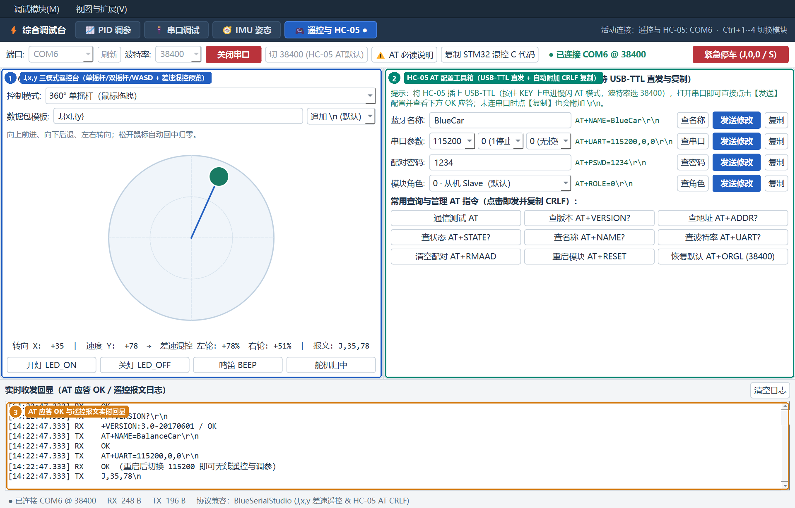

- **顶部【🔵 蓝牙扫描与配对】展开抽屉**：支持一键点击 **【🔍 搜索附近蓝牙】** 扫描周边模块（或 **【↻ 已配对设备】** 瞬间列出已配对设备及系统自动分配的传出 `COM` 口）；填入 `PIN` 码（HC-05 默认 `1234`）即可点击 **【🔗 配对选中】** 完成系统级配对，并直接通过 **【⚡ 蓝牙直连 (SPP)】**（底层 RFCOMM 通道）或 **【🔌 用映射串口连接】** 控制小车；不需扫码时可点顶栏按钮随时收起该面板。

- **左侧 `J,{x},{y}` 差速遥控台**：支持 **360° 单摇杆**、**左右双摇杆（左油门 `Y` / 右转向 `X` 独立归零）**、**四按键 / 键盘 `WASD` 长按加速（`18%` 起步、`1.6 s` 满速 `100%`）** 三种模式，实时展示 `BlueSerial_MixWheels` 左右轮差速混控百分比；当页面隐藏、窗口失焦/弹窗或切页时自动清零所有按键并发送 `J,0,0` 防止飞车卡键，按住非零摇杆每 `100 ms` 自动重发维持车端看门狗；断开串口前会先冲洗下发 `J,0,0` 与 `S`，并可一键复制 STM32 混控 C 代码。
- **右侧 HC-05 AT 配置工具箱（USB-TTL 直发 + 复制）**：将 HC-05 插上电脑 USB-TTL（按住 `KEY` 上电红灯慢闪进 AT 模式，点击顶部 **【切 38400】** 并打开串口），即可直接点击 **【发送修改】** 在线配置蓝牙名称（`AT+NAME=`）、串口波特率（`AT+UART=`，完整覆盖 `57600` 并对疑误旧项 `5760` 弹窗二次确认；在线写入前会先发送 `AT+UART?` 读出当前参数对比确认）、配对密码（`AT+PSWD=`）与主从角色（`AT+ROLE=`），所有指令自动附加 `CRLF (\r\n)` 并在下方回显窗口实时显示 `OK` 响应。

---

## 11. STM32 固件协议速查与平衡车接入指南

项目目录 `firmware_example\` 下提供了可直接放入 STM32CubeIDE / Keil 工程的 C99 源码：
- [pid_link.c](../firmware_example/pid_link.c) / [pid_link.h](../firmware_example/pid_link.h)：纯整数运算实现浮点收发解析（**无需 `-u _printf_float`**，为 F103C8 节省十几 KB Flash），内置 `500 ms` 心跳超时看门狗、**8 通道上报 `PID_ReportValues()`**、**原子组更新 `@<GRP>.SET=kp,ki,kd,tgt`**、`PID_PositionRate()`（陀螺仪角速度直接作微分项）与中断安全的 `PID_Fault()`。
- [hal_demo.c](../firmware_example/hal_demo.c)：HAL 串口单字节中断接收环形缓冲 + 应答优先于波形的非阻塞发送队列。
- [balance_example.c](../firmware_example/balance_example.c) / [balance_example.h](../firmware_example/balance_example.h)：`5 ms` 定时器中断三环串级模板（直立环 `ANG` + 速度环 `SPD` + 转向环 `YAW`、死区补偿、`40°` 倒地保护），只需实现 `Board_ReadImu`、`Board_ReadEncoders`、`Board_SetMotors` 三个硬件钩子即可上车联调。

| 通信方向 | 报文示例 | 含义说明 |
| :--- | :--- | :--- |
| `MCU → PC` | `150.0,148.5,620,1.5\n` | **1～8 通道**实时采样数据行（支持可选前缀 `tag:v1,v2`） |
| `MCU → PC` | `#NAMES:pitch_tgt,pitch,pwm,speed\n` | 自动更新上位机通道默认占位名称 |
| `MCU → PC` | `#ROLES:target,actual,output,other\n` | **v1.8 新增**：声明各列角色，支持任意通道顺序自动匹配实际反馈与输出 |
| `MCU → PC` | `#CAP:PING\n` / `#CAP:SET\n` / `#STOP:heartbeat\n` / `#STOP:fall\n` | 启用心跳保护 / 启用原子 `@SET` / 心跳超时停机 / 倒地停机通知 |
| `PC → MCU` | `@RUN\n` / `@STOP\n` / `@PING\n` | 启动控制输出 / 紧急停机并清零输出 / `200 ms` 周期保活心跳 |
| `PC → MCU` | `@SPD.KP=3.5000\n` / `@SPD.SET=3.5,1.2,0.1,80\n` / `@SPD.GET\n` / `@SPD.RST\n` | 单项写入 / **原子组写入四参数（全校验通过一次生效）** / 读回参数 / 清零积分 |
| `MCU → PC` | `@ACK:SPD.SET=3.5,1.2,0.1,80\n` / `@PARAM:SPD.KP=3.5,...\n` | 原子或单项确认应答 / 整组参数读回应答 |

> [!CAUTION]
> **实车首次上电安全检查清单**
> 首次接入电机驱动器前，请务必**将平衡车车轮架空离开地面**，依次验证：① 按键盘 `Esc` 车轮是否立即停转并回传 `@ACK:STOP`；② 运行中直接拔掉 USB-TTL 串口线，`0.5 s` 内电机是否因心跳超时自动停转；③ 手动将车身倾斜超过 `40°`，是否立即触发 `#STOP:fall` 切断 PWM 输出。
